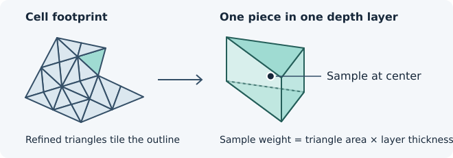
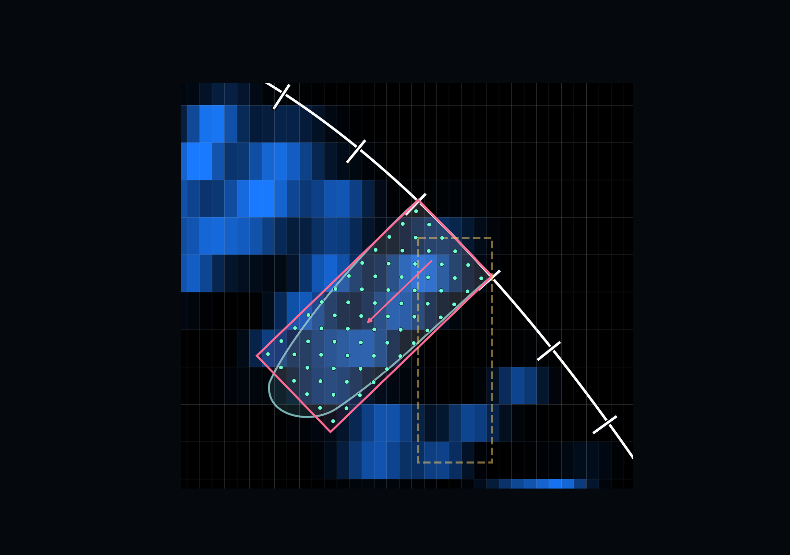

# Measure fluorescence along the cell surface normal

On a tilted part of a tissue, sampling straight down through the image stack
can move you sideways relative to the cell interior. DeProjPy uses the
deprojected cell outline to aim the sampling region perpendicular to the
local surface. This gives you a way to compare fluorescence at similar
depths beneath cells with different orientations.


*In this cross-section, the pink region follows the local surface normal.
The dashed gold region follows the stack's Z axis. The cell interior is
schematic.*

## How a region becomes a fluorescence measurement

1. **Build the region.** DeProjPy fits a flat plane to the cell's 3D boundary
   and projects the outline onto that plane. It extends the outline along
   the direction perpendicular to the plane (the *normal*) over the depth
   interval you choose. The result is a prism with the cell's outline as its
   footprint. It approximates a part of the cell and can overlap a nearby
   cell's prism.
2. **Place points inside it.** DeProjPy divides the footprint into small
   triangles and the depth interval into layers. Each triangle and layer
   together form a small piece of the prism. DeProjPy takes one sample at
   the center of each piece. The pieces cover the requested depth interval,
   and each sample represents the volume of its piece (triangle area times
   layer thickness).
3. **Read the fluorescence at each point.** The points usually fall between
   voxel centers. DeProjPy estimates the intensity there by blending the
   neighboring voxel values according to distance along each image axis.
   This is *trilinear interpolation*, using up to eight neighbors in 3D.
   A voxel just beyond the prism can help estimate a point inside it.
4. **Combine the samples.** For a mean, multiply each sampled intensity by
   the volume it represents, add the products, and divide by the contributing
   volume. A sample representing twice the volume has twice the influence.
   The same idea gives volume-weighted medians and histograms.



The triangles fit together to cover the cell outline, including any inward
corners. Extending one triangle through one depth layer gives a small
triangular prism. The point at its center supplies the intensity estimate
for that piece, and the triangle’s area times the layer’s thickness gives
the volume it represents.



*The points in the pink region are where DeProjPy estimates intensities.
They are distinct from the voxel centers where the image was acquired.
The weights used for the statistics come from the pieces of the prism,
rather than from intersecting the prism with individual image voxels.*

This method of estimating a volume measurement from weighted points is
called *quadrature*. Set `sampling_spacing` to control the size of the
triangles and layers. It defaults to the result's XY pixel size. Smaller
spacing usually gives more points and takes longer. It can refine the
numerical estimate using the same image data.

## Choose the depth and measure a channel

Start with a deprojection `result` and an aligned fluorescence stack. This
example uses a two-channel array ordered as `(channel, z, y, x)`, the usual order in which microscopy images are encoded.

```python
from deprojpy import intensity

regions = intensity.prepare_regions(
    result,
    depth_range=(-1, 5),
    depth_units="slices",
    tissue_side="increasing_z",
)
values = intensity.measure(
    stack_czyx,
    regions,
    channel_names=["membrane", "cytosol"],
    channels=[1],
    measurements=("mean", "std"),
)
frame = values.to_dataframe()
```

Choose `tissue_side="increasing_z"` if the interior is toward higher slice
indices in the **original acquisition stack**. Use `"decreasing_z"` for
the opposite direction. Positive depths go toward the interior and negative
depths go to the other side of the fitted plane.

With `depth_units="slices"`, each depth unit is one Z slice spacing measured
*along the normal*. For example, with 0.5 µm between slices, `(-1, 5)` runs
from −0.5 to +2.5 µm, even for a tilted cell. You can also give depths in
the result's length units, `um`/`µm`, or `mm`.

By default, the stack uses the result's Z spacing and XY pixel size.
For a cropped or resampled stack, supply
`calibration=intensity.StackCalibration((dz, dy, dx), (z0, y0, x0))`
to `prepare_regions`. Use the result's length units for both the spacing
and the origin. The origin is the physical location, in the original
acquisition coordinates, of the supplied stack's first voxel center.
Results saved before schema 1.2 require an explicit `z_reflected` and,
for reflected results, `z_reflection_offset`.

## Name and select channels

| What you have | How to pass it |
| --- | --- |
| One 3D stack, ordered `(z, y, x)` | Pass the array. Optionally name it with `channel_names="GFP"`. |
| One 4D stack, ordered `(channel, z, y, x)` | Optionally give one name per channel in stack order. Select channels by their original positions, starting at zero. |
| Separate aligned 3D stacks | Pass a dictionary such as `{"GFP": gfp_zyx, "Delta": delta_zyx}`. Select by dictionary key, for example `channels="Delta"`. |

For a 4D stack, `channels=[2, 0]` measures the third channel first, then
the first, even if you supply custom names. Omit `channels` to measure all
channels in the stack or dictionary.

## Read the measurements and check coverage

Each row corresponds to one cell and one channel. Use `id` to link back
to the deprojection result and `source_label` to link to the original
label image when available.

A prism can extend past the stack. DeProjPy keeps sample points that fall
within the range of voxel centers, from the first to the last center on each
axis. A point inside that range contributes the full volume of its piece
to `sampled_volume`; a point outside contributes zero. Pieces that cross
the boundary therefore give an approximate coverage estimate. If coverage
matters to the analysis, check how it changes with a smaller
`sampling_spacing`.

| Column | What it tells you |
| --- | --- |
| `requested_volume` | Volume of the whole prism |
| `sampled_volume` | Volume represented by points inside the stack |
| `finite_volume` | Volume represented by in-stack points with finite intensities in this channel |
| `coverage_fraction` | Sampled volume divided by requested volume, when defined |
| `clipped` | Whether the prism extends beyond the stack's sampling bounds |
| `status`, `reason` | Whether the result is usable as sampled, and any issue found |

A clipped prism can still give a useful measurement of the part inside
the stack. If the prism might overlap the stack but no sampling point lands
inside it, the status is `unresolved_sampling_coverage`. If the prism is
geometrically outside the stack, the status is `outside_stack`. Points
with NaN or infinite interpolated intensities are left out of the intensity
statistics. With no finite samples, those statistics are NaN. A finite
zero is a valid intensity.

## Choose statistics

The default returns the mean, median, standard deviation, and volume
information. All coverage columns above are included even when you request
only one intensity statistic.
**Streaming** means DeProjPy updates the statistic as it reads samples,
without keeping all their intensities in memory. Median, quartiles, and
mode need to retain the samples for each cell and channel.

| Metric | What DeProjPy calculates | What it requires |
| --- | --- | --- |
| `mean`, `std` | Volume-weighted mean and population standard deviation | Streaming |
| `minimum`, `maximum` | Lowest and highest finite sampled intensities | Streaming |
| `integrated_intensity` | Sum of intensity × represented volume | Streaming |
| `raw_sample_sum` | Sum of sampled intensities. Depends on the number of sampling points. | Streaming |
| `q25`, `median`, `q75` | Volume-weighted quartiles | Retains samples and finds the intensity at each requested cumulative-volume threshold |
| `mode` | Midpoint of the histogram bin with the most represented volume per unit of intensity | Retains samples, builds a weighted histogram, and uses SciPy interpolation for the entire call |

The default includes `median`. If you only need the mean and standard
deviation, use `measurements=("mean", "std")` to skip retaining the samples
and finding the median, which takes time and memory. The volume and coverage columns are still included.

**Mode can be noticeably slower.** It needs to keep the samples for the
histogram and uses the SciPy interpolation routine for the whole call so
that samples on bin edges are assigned consistently. Use `mode_bins="auto"`,
a positive bin count, or explicit increasing bin edges. Automatic bin
edges are chosen from the intensities alone. Each sample then adds its
volume weight to the histogram, and the winning bin is chosen after
dividing by bin width. Ties go to the lower bin. Values outside explicit
edges are excluded. A constant distribution within the chosen range
returns that constant. The table records the edges in `mode_bin_edges`.
Use `measurements="all"` to request every statistic, including mode.

## Inspect a prism and save your results

```python
cell_id = int(result.to_dataframe().iloc[0]["id"])
intensity.plot_region_preview(result, regions, cell_ids=[cell_id])
intensity.plot_feature_map(result, values, channel="cytosol", feature="mean")
values.save("intensity-results.npz")
```

The preview shows the cell boundary, the two ends of the prism, and the
positive-depth direction. Check it when choosing depth or tissue side. The
archive keeps the table and settings, including calibration and selected
metrics. It contains no image data.

See the [cookbook](cookbook.md#preview-prisms-and-measure-fluorescence)
for a coverage check and the
[synthetic example](../examples/06_surface_normal_intensity.py) for a
workflow you can run without an acquisition stack.
